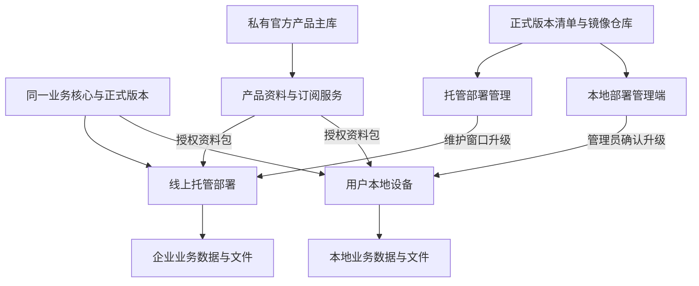

# 线上托管、本地设备与官方产品库架构

Date: 2026-10-21
Status: 架构基线已确定；以下模块合同与实施拆分待按 Plan 028 落地验收。

本文件说明如何实现 [ADR 0010](adr/0010-hosted-local-deployment-and-optional-catalog.md)。领域词汇以 [CONTEXT](../CONTEXT.md) 为准，客户工作流继续遵守 ADR 0005—0007；现有 CAD、图片整理及客户项目不由本规划改写。

## 1. 产品形态

| 交付方式 | 使用入口 | 业务数据位置 | 维护责任 | 产品资料来源 |
| --- | --- | --- | --- | --- |
| 线上托管版 | 浏览器访问官方域名 | 托管环境，按企业/个人业务空间隔离 | 运营方负责升级、备份及恢复 | 自建、官方订阅或混合 |
| 本地设备版 | 浏览器访问已配好设备的局域网地址 | 用户自己的设备；也可显式配置自己的 PostgreSQL | 预装交付，管理员确认升级；维护范围另定 | 自建、官方订阅或混合 |
| 开源自行部署 | 用户自己的部署入口 | 用户指定的业务数据库与文件存储 | 用户自行运维 | 自建；可选官方订阅 |

前两行是商业交付形态；开源自行部署继续作为同一核心的部署途径，不另做一套业务系统。软件正式版本、官方产品资料版本、业务数据库结构版本独立记录，不用一个版本号兼任三者。

黑豹 X2 是首批设备交付候选载体。2026-10-21 实机确认首台候选机为 RK3566 / arm64 / 3.8 GiB 内存 / 29 GB eMMC、Armbian（Debian 13）、Docker 26.1.5；该机已跑通首次部署、备份真实恢复与一次版本更新（见 `plans/033`）。**发货型号、系统、网络与容量仍需按批次实机确定**，不能把这一台的规格当作交付承诺。线上版继续处于准备阶段。

## 2. 系统边界

图中的资料包流向不代表客户端可以直接连接私有主库。授权校验可以向官方发送实例标识、所选订阅范围和同步版本；客户名称、项目图纸、报价、用户自建产品与进货成本不属于同步请求内容。未来如提供远程支持或项目迁移，需另外设计明确操作与数据范围。

| 模块 | 责任 | 首版实现取向 |
| --- | --- | --- |
| 业务应用 | 点位、选型、报价、交付、账号与权限 | 复用 Next.js、PostgreSQL 和现有业务服务，保持单体 |
| 产品来源适配层 | 自建资料、官方同步资料、本地有效产品 | 业务层读取部署内有效产品，离线设计不逐次请求官方服务 |
| 产品资料与订阅服务 | 整理审核、资料发布、授权、范围和同步 | 独立服务与数据库；前台只接收允许分发的发布资料 |
| 版本发布流程 | 校验、打包、版本说明、发布清单 | 基于现有 CI 增加正式版本发布，源码、镜像与清单对应同一版本 |
| 部署管理端 | 镜像更新、维护锁、迁移、健康检查、恢复 | 独立于业务容器；本地只暴露限定的更新任务 |
| 文件存储适配层 | 图片、底图、附件、交付素材的持久化与读取 | 本地目录/数据卷和线上对象存储使用同一业务接口 |

业务核心、客户端同步逻辑与合同可在开源仓库维护。官方主库、商业服务运营配置、授权签发密钥与设备出厂凭据独立私有维护。原业务工作区是业务资料环境，不能直接用它的工作区内容构建公共发行镜像；从脱敏开源发行源构建并检查产物。

## 3. 数据所有权与离线能力

- **业务数据**：企业或个人业务空间拥有自己的项目、点位、报价、成员及文件。本地版默认 PostgreSQL 与文件数据卷随设备保存；更换应用容器不删除它们。外接自己的 PostgreSQL 属于业务连接配置，不等于接入官方产品库。
- **官方资料**：只发布审定范围内的型号、参数、核验状态、来源、可分发图片及有日期/适用条件的参考价格。官方内部成本、供应商资料、客户数据、采集底稿及凭据不默认发布。
- **用户产品资料**：新增产品、自己的价格/成本、渠道、备注和库存只归本部署的业务空间。官方同步不自动上传这些资料。
- **本地离线合同**：使用本地账号登录、编辑与保存方案、查已下载产品、生成固定交付和导出，不依赖官方服务或外部文件 URL。可用字体、图标、必要产品图片及附件必须本地具备；缺资料显示缺失原因。离线不承诺获取新版本、新产品、远程图片或完成在线授权。
- 浏览器 IndexedDB 仍只承担编辑副本与缓存；跨电脑访问依赖服务器已保存资料。备份包含数据库、文件、配置恢复说明及版本信息；敏感配置应受控保存。
- 线上多企业可共用基础设施，但每项业务数据和私有素材都必须通过服务端校验空间归属。现有账号/企业表不能作为“所有接口已隔离”的验收证据；产品目录、检索、导出、上传/下载、后台操作也要核查。

## 4. 官方产品同步合同

首版提供自建、官方、混合三种来源选择。自建模式完全不要求官方授权码；“官方”表示以官方资料为主要来源，不禁止用户保留项目价格与备注。

数据模型按下列职责增量扩展，具体表名在实施中确定：

| 记录 | 最小职责 |
| --- | --- |
| 产品来源 | 标识官方提供方、资料范围与业务空间；区分自建记录 |
| 上游产品资料 | 保存稳定上游 ID、上游修订、来源/核验信息、资料合同版本与内容摘要 |
| 产品映射 | 使用提供方、业务空间、上游 ID 唯一映射到既有本地产品 ID |
| 本地覆盖 | 保存本地价格、成本、库存、备注和对官方字段的显式修改 |
| 同步批次 | 记录范围、计划、冲突、应用结果、失败原因、游标和可恢复位置 |
| 产品库订阅 | 保存有权同步的范围与有效期；与业务套餐分开 |

`products.id`、内部 `sku`、厂家型号和官方上游 ID 各有用途，不能互换。上游修订不能冒充本地 `mappingRevision`，本地已有的并发控制、父系列、产品核验与审计规则继续生效。

同步流程为：检查授权和资料兼容性 → 下载并暂存资料及素材 → 校验大小/摘要/素材范围 → 生成差异预览 → 管理员确认 → 分批事务应用 → 读回检查并确认游标。重复执行相同批次不得重复建产品；失败从已提交位置恢复，不用未完成游标跳过数据。

| 上游变化 | 默认处理 |
| --- | --- |
| 新型号 | 创建来源映射和产品，保留原始核验状态；无证据不能自动升为已核验 |
| 用户未改过的官方字段更新 | 按差异预览应用，更新本地修订与核验依据 |
| 用户改过的字段被上游更新 | 保留本地覆盖，展示上游差异，允许逐项接受或继续保留 |
| 官方参考价更新 | 更新参考价，不默认覆盖企业成本、对客售价或项目实际单价 |
| 停产、下架、资料撤回 | 标记来源状态和待核事项，保留本地身份、已有引用和历史记录 |
| 官方图片更新 | 先归档可用素材；按现有独立图库流程更新当前资料，旧交付不回写 |
| 不支持的设备类型或资料合同 | 明确显示需要兼容版本，停止相关批次，不导入未知字段 |
| 授权到期、断网或官方服务不可用 | 停止新资料同步，已有产品和本地业务继续可用 |

同步应用应复用现有产品写入、参数验证、版本与审计服务。当前管理员 PATCH 要求完整基础字段，不能把上游局部差异直接透传为请求，否则可能清空价格、图片等字段；实现时先读完整本地记录并合成有效值，或抽取可复用的受控领域写入入口。不得建立绕过业务校验的批量直写脚本。

本机历史产品首次成为官方发布目录需人工建立归属和上游映射，不能把整个业务数据库克隆给订阅者。售后恢复设备或重装时保留实例归属，换机与解绑规则后续明确，避免仅以固定硬件指纹永久锁死资料访问。

## 5. 软件版本与 Docker 升级合同

- 正式版本对应固定源码提交与镜像摘要；生产更新选择明确目标版本，不追随开发分支。发布前执行现有 CI，并在干净安装库和上一支持版本数据上演练迁移。
- 版本清单包含当前/目标版本、镜像摘要、支持平台、最低升级版本、数据库兼容范围、资料合同兼容范围、更新说明及发布认证信息。校验可信签名/发布来源；仅有内容摘要不能证明发布者身份。
- 先验收发货设备对应的 CPU 架构与依赖；只有完成验证的平台才发布支持说明，不能把跨架构构建成功等同于设备验收。
- 自动检查并缓存正式版本信息，支持手动检查；频率建议每日一次，网络失败不阻断业务。权限范围为部署管理员，普通企业成员不能升级共享托管实例。
- 本地管理员点击更新后，由配套部署管理端执行。业务容器不挂 Docker socket、不接收任意命令或任意镜像地址；任务只允许已确认的可信版本，执行互斥、管理员校验与任务审计。
- 升级状态为：可更新 → 预检查 → 下载 → 维护/暂停写入 → 数据库及文件备份完成 → 按兼容计划迁移 → 切换应用 → 健康检查 → 恢复服务。下载可在维护前完成；迁移和备份期间不能留下浏览器显示成功但实际写入被丢弃的状态。
- 校验磁盘、备份可读性、当前数据库版本和迁移路线；应用、数据库和文件采用匹配恢复点。无合适备份、未支持的跨版本路线或不可恢复的迁移须明确阻止执行。
- 未改数据库且满足兼容性时，可回到旧镜像；迁移后优先按声明的兼容策略处理，否则由管理员选择恢复完整备份。不能宣称任何升级失败都能无损自动回滚；恢复点之后的写入需明确告知并处理。
- 托管版由运营方安排维护窗口执行同类流程；各本地实例独立选择升级时间。软件升级不自动同步官方产品库，也不将客户项目推到云端。

产品资料、迁移包等下载接口不得把官方服务凭据放进浏览器公共变量或镜像。更新认证、产品订阅授权和本地用户登录分别处理，官方产品服务不能借版本检查下发任意宿主机操作。

## 6. 权益边界与界面入口

| 权益 | 控制范围 | 到期影响 |
| --- | --- | --- |
| 线上托管服务 | 托管资源及服务套餐 | 宽限、访问、导出与保留期限另定，不沿用产品库到期行为 |
| 官方产品库订阅 | 可同步的产品范围、资料版本与有效期 | 停止获取新增资料和更新；已同步资料与本地方案继续使用 |
| 设备维护/支持 | 安装、维护、售后与换机服务 | 支持期限另定；不以此删除客户数据或混同产品库权益 |

开源软件不以购买官方产品库作为使用前提。现有个人免费/升级版及企业套餐实现保留为当前事实；进入正式发行前，需单独决定哪些限制适用于托管服务、哪些适用于自行部署及预装设备，再调整权限策略。不能仅凭部署环境变量由浏览器关闭权限校验。

建议管理员入口：

- **产品库 → 资料来源与同步**：选择来源、激活订阅、查看范围/版本/日期、预览差异、处理冲突、同步记录。
- **系统设置 → 关于与更新**：当前版本、新版本、更新说明、兼容要求、检查与更新任务进度。
- **系统设置 → 备份与恢复**：备份结果、可恢复范围、导出、恢复预检；高权限恢复明确显示影响实例。
- **系统设置 → 部署与维护**：部署方式、设备/实例标识、网络与存储健康；不显示密钥、密码或完整连接串。

业务界面显示“官方资料 / 自建 / 有本地修改”、资料核验状态和参考价日期即可，不要求用户理解数据库表与镜像操作。

## 7. 当前差距与实施边界

| 目前已有 | 仍需建设/验证 |
| --- | --- |
| Next.js standalone Docker 构建、PostgreSQL、CI | 正式版本镜像发布、可信版本清单、检查更新与部署管理端 |
| 企业账号与权限基础 | 托管环境全链路企业隔离；两种部署下的套餐权限政策 |
| 产品、核验、图库、修订与审计 | 资料来源、上游映射、本地覆盖、授权同步与幂等批次 |
| IndexedDB 编辑缓存、数据库图片与固定交付归档 | 通用上传仍依赖 Vercel Blob；本地持久化文件适配与完全断网演练 |
| 原有迁移入口 | 版本兼容声明、维护锁、备份恢复演练和发货设备验收 |

本轮只确定框架与实施顺序，不上线托管服务、不发售设备、不启用收费、不改现有客户数据，不声称更新/同步/离线交付功能已经可用。

具体服务域名、镜像仓库、发货配置、价格、支持期限、托管到期政策及支付渠道在对应阶段确定，不阻塞先完成本地数据与版本基础。
